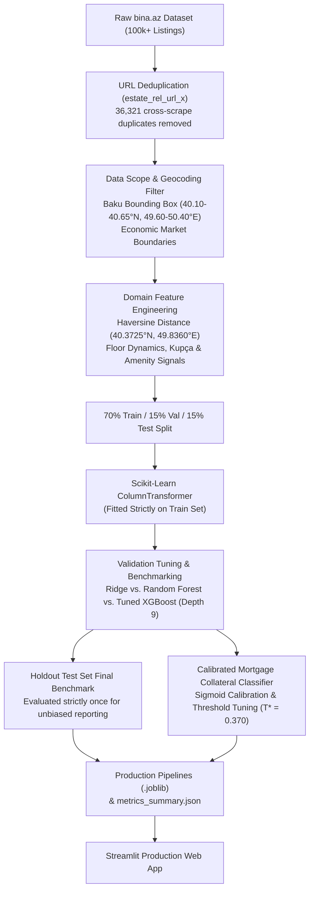

# Automated Valuation Model (AVM) & Mortgage Collateral Risk Engine
### Machine Learning Valuation, Risk Triage, and Spatial Analytics for Baku Residential Real Estate

[](https://www.python.org/)
[](https://scikit-learn.org/)
[](https://xgboost.readthedocs.io/)
[](https://streamlit.io/)
[](LICENSE)

> **Live Application:** [baku-real-estate-valuation-gtdwutcxd4luruxzxjkkhg.streamlit.app](https://baku-real-estate-valuation-gtdwutcxd4luruxzxjkkhg.streamlit.app)  
> **Repository:** `https://github.com/nazrinasgarova/baku-real-estate-valuation`

---

## Project Overview & Context

This project develops an automated real estate valuation and mortgage underwriting engine for residential properties across Baku and the Absheron Peninsula, Azerbaijan. Built on an empirical dataset of over 100,000 marketplace listings from `bina.az`, the system addresses two foundational banking use cases:
1. **Automated Valuation Model (AVM):** Estimating fair market property values with narrow error margins to accelerate loan origination workflows.
2. **Mortgage Collateral Underwriting:** Screening high-value properties ($\ge 300,000$ AZN) via calibrated probability classification for portfolio risk management.

### Key Highlights & Standards:
* **Leakage-Free URL Deduplication:** Filtered 36,321 duplicate listings across scrape timestamps on `estate_rel_url_x`, eliminating target leakage and artificial memorization.
* **Strict Evaluation Partitioning:** 70% Train (40,394), 15% Validation (8,656), and 15% Holdout Test (8,657). The unseen test set is evaluated strictly once for final reporting.
* **Standard AVM Metrics:** Evaluation based on **Median Absolute Percentage Error (MedAPE)**, **PPE10** (% within $\pm 10\%$), and **PPE20** (% within $\pm 20\%$).
* **Model Benchmark:**
  * **Tuned XGBoost (Deployment Champion):** Test $R^2 = \mathbf{0.8390}$, Test $\text{MAE} = \mathbf{33,923.90\text{ AZN}}$, $\text{MedAPE} = \mathbf{7.46\%}$, $\text{PPE10} = \mathbf{60.9\%}$, $\text{PPE20} = \mathbf{84.6\%}$, **5.6 MB** artifact size.
  * **Streamlined Model:** Top 10 features, Test $R^2 = \mathbf{0.8111}$, $\text{MAE} = \mathbf{40,055.32\text{ AZN}}$, $\text{MedAPE} = \mathbf{9.46\%}$, $\text{PPE10} = \mathbf{52.2\%}$, $\text{PPE20} = \mathbf{77.7\%}$, **5.5 MB**.
  * **Random Forest (Ensemble Benchmark):** Test $R^2 = \mathbf{0.8281}$, Test $\text{MAE} = \mathbf{35,042.88\text{ AZN}}$, $\text{MedAPE} = \mathbf{7.46\%}$, $\text{PPE10} = \mathbf{60.9\%}$, $\text{PPE20} = \mathbf{83.4\%}$, compressed to **26.5 MB** (`compress=3`, safely within GitHub's 100 MB limit).
  * **Ridge Regression (Linear Baseline):** Test $R^2 = 0.3177$, Test $\text{MAE} = 60,652.16\text{ AZN}$, $\text{MedAPE} = 13.90\%$, $\text{PPE10} = 38.5\%$, $\text{PPE20} = 64.4\%$.
* **Champion Selection Rationale:** Accuracy between Random Forest (MedAPE 7.46%, PPE10 60.9%) and Tuned XGBoost (MedAPE 7.46%, PPE10 60.9%) is practically tied, with XGBoost achieving slightly better $R^2$ (0.8390 vs. 0.8281) and MAE (33,924 vs. 35,043 AZN). XGBoost is selected as the production deployment champion primarily due to its compact 5.6 MB memory footprint (almost 5x smaller than Random Forest's 26.5 MB) and ~4x faster inference latency (~10–20 ms vs. ~66 ms), enabling rapid container cold starts, reduced RAM utilization, and efficient microservice serving.
* **Collateral Triage & Calibration:** Calibrated probability classification for High-Value Collateral ($\ge 300,000$ AZN) yielding optimal decision threshold $T^* = 0.370$, Validation AUC: **0.9828**, Test Accuracy: **93.81%**.
  * *Honest Calibration Assessment:* Sigmoid calibration did not improve the Brier score (0.0433 uncalibrated vs. 0.0446 calibrated), confirming that raw gradient boosted trees were already well-calibrated. Post-hoc calibration is retained in the production pipeline primarily as an illustrative pipeline component to enforce sigmoid probability scaling.

---

## Technical Architecture & Pipeline



---

## Empirical Benchmarks (Holdout Test Set)

| Model Configuration | Role | Test $R^2$ | Test MAE | MedAPE | PPE10 ($\pm 10\%$) | PPE20 ($\pm 20\%$) | Artifact Size | Latency |
| :--- | :--- | :---: | :---: | :---: | :---: | :---: | :---: | :---: |
| **Tuned XGBoost** (Depth 9) | **Deployment Champion** | **0.8390** | **33,923.90 AZN** | **7.46%** | **60.9%** | **84.6%** | **5.6 MB** | **~10–20 ms** |
| **Random Forest** | **Ensemble Benchmark** | **0.8281** | **35,042.88 AZN** | **7.46%** | **60.9%** | **83.4%** | **26.5 MB** | ~66 ms |
| **Streamlined XGBoost** | **Top 10 Features** | **0.8111** | **40,055.32 AZN** | **9.46%** | **52.2%** | **77.7%** | **5.5 MB** | ~10–20 ms |
| **Ridge Regression** | **Linear Baseline** | 0.3177 | 60,652.16 AZN | 13.90% | 38.5% | 64.4% | < 1 MB | < 1 ms |

---

## Limitations & Practical Considerations

1. **Asking Prices vs. Finalized Transactions:** Marketplace listings from `bina.az` reflect seller asking prices. An assumed 3% to 7% buyer bargaining discount is an illustrative market assumption commonly referenced in transaction practice, not empirically estimated from this dataset.
2. **Kupça (Property Deed) Nuances:** Kupça presence carries an empirical +80.3% premium in detached houses and villas (1,312 vs. 728 AZN/m²). For newly constructed luxury apartments, one possible contributing factor in market practice is that premium apartment projects under construction are frequently contracted prior to master deed issuance.
3. **Price Tier Variance:** Valuation accuracy varies across market brackets: error rates are lowest on typical mid-market homes (100k-400k AZN), while budget properties (<100k) and luxury homes (>400k) exhibit wider percentage error margins due to unrecorded parcel sizes and bespoke interior finishes.
4. **Temporal Scope:** The dataset represents cross-sectional marketplace scrape snapshots from autumn 2024 and should be periodically updated to reflect interest rate movements and macroeconomic shifts.

---

## Repository Structure

```
baku-real-estate-valuation/
│
├── Project_bina_az_real_estate_valuation.ipynb  # End-to-end ML notebook (119 cells, 26 plots, zero errors)
├── app.py                                      # 3-Tab Streamlit production web app
├── README.md                                   # Comprehensive project documentation
├── requirements.txt                            # Production package dependencies
├── requirements-dev.txt                        # Development and execution dependencies
├── .gitignore                                  # Git ignore rules for data and cache
│
├── src/                                        # Modular python source package
│   ├── __init__.py
│   ├── features.py                             # Haversine distance, string cleaners, amenity signals
│   └── preprocessing.py                        # Preprocessing logic and coordinate transformations
│
└── models/                                     # Exported production model artifacts
    ├── champion_xgb_pipeline.joblib            # Deployment Champion XGBoost Pipeline (5.6 MB)
    ├── random_forest_regressor.joblib          # Random Forest Ensemble Benchmark (26.5 MB)
    ├── streamlined_xgb_pipeline.joblib         # Streamlined Low-Feature Pipeline (5.5 MB)
    ├── calibrated_classification_pipeline.joblib # Calibrated Collateral Classifier (0.3 MB)
    └── metrics_summary.json                    # Dynamic benchmark statistics for Streamlit app
```

---

## Quickstart & Setup

### 1. Clone Repository & Install Dependencies
```bash
git clone https://github.com/nazrinasgarova/baku-real-estate-valuation.git
cd baku-real-estate-valuation

# Create and activate virtual environment
python -m venv venv
venv\Scripts\activate  # On Windows (or 'source venv/bin/activate' on Linux/macOS)

# Install pinned dependencies
pip install -r requirements.txt
```

### 2. Launch Streamlit Application
The repository comes pre-packaged with all serialized model artifacts in `models/`, allowing you to run the interactive dashboard immediately:
```bash
streamlit run app.py
```
The application will open in your browser at `http://localhost:8501`.

### 3. Run Jupyter Notebook (Optional)
To re-run the full training and analysis pipeline from scratch:
1. Download `house_sale.csv` from [Kaggle Binaaz sale project](https://www.kaggle.com/datasets/sehriyarmemmedli/binaaz-sale-project) and place it in the project root.
2. Install development tools and execute:
```bash
pip install -r requirements-dev.txt
jupyter notebook Project_bina_az_real_estate_valuation.ipynb
```

---

## Data Source & Academic Attribution

* **Dataset:** [Binaaz sale project](https://www.kaggle.com/datasets/sehriyarmemmedli/binaaz-sale-project)
* **Author / Collector:** Shahriyar Mammadli
* **Collection Method:** Web scraping of publicly available real estate listings from `bina.az` across Baku and the Absheron Peninsula (autumn 2024).
* **Usage:** For educational, research, and non-commercial portfolio purposes.
