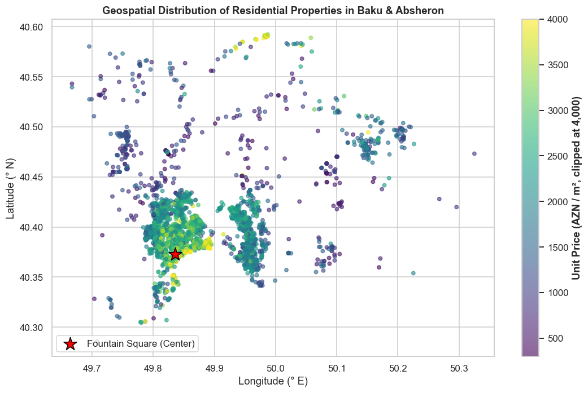
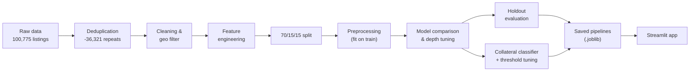
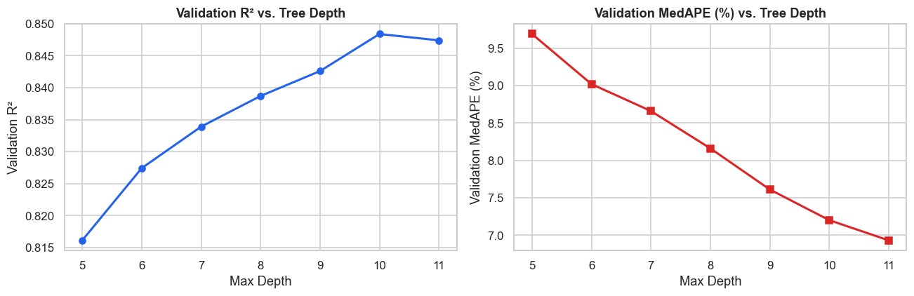
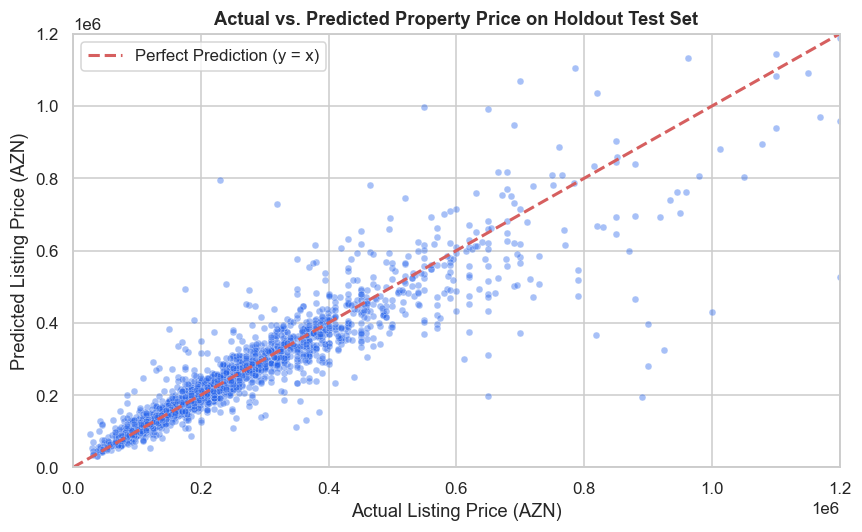
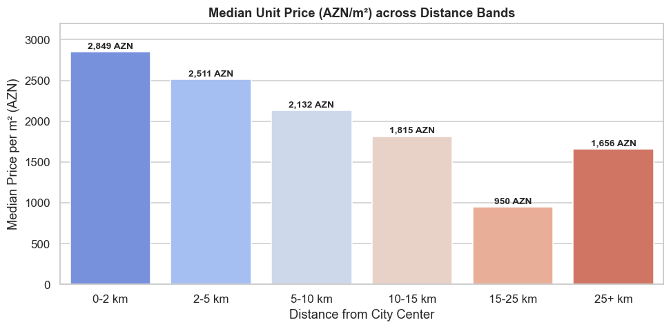
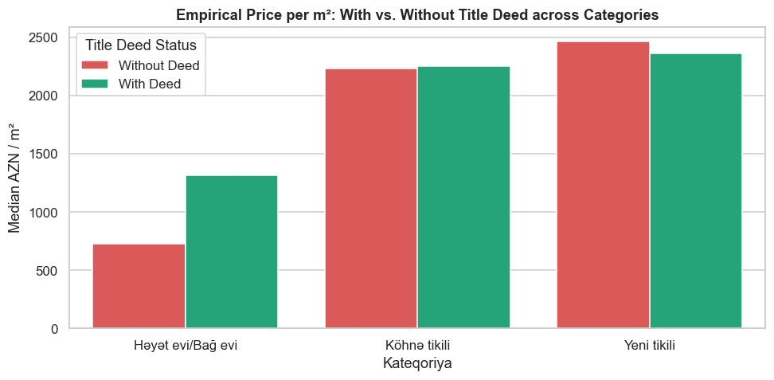
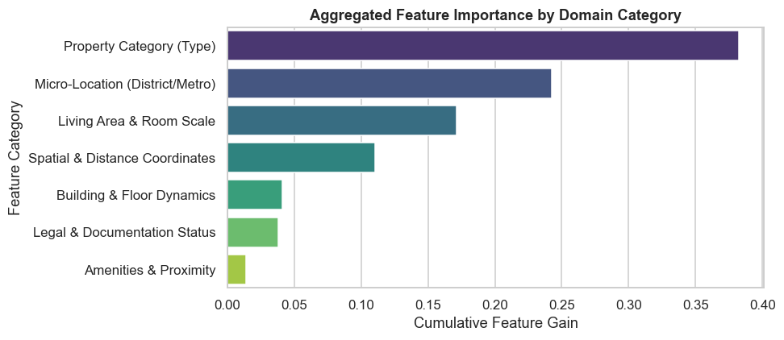
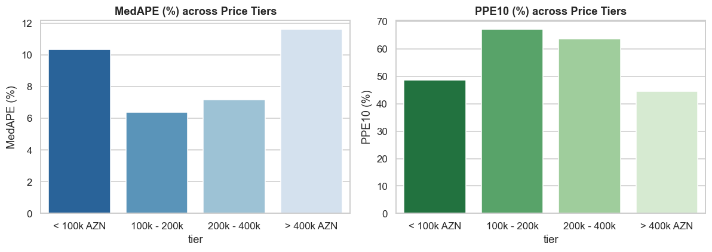
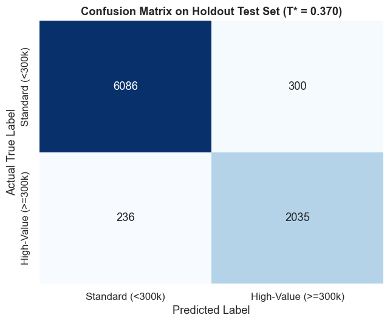

# Baku Real Estate Valuation & Mortgage Collateral Risk

Automated Valuation Model (AVM) and high-value collateral classifier for residential property in Baku and the Absheron Peninsula, trained on 57,707 cleaned `bina.az` listings.

[](https://www.python.org/)
[](https://scikit-learn.org/)
[](https://xgboost.readthedocs.io/)
[](https://baku-real-estate-valuation-gtdwutcxd4luruxzxjkkhg.streamlit.app)
[](LICENSE)

**Live application:** [baku-real-estate-valuation-gtdwutcxd4luruxzxjkkhg.streamlit.app](https://baku-real-estate-valuation-gtdwutcxd4luruxzxjkkhg.streamlit.app)

<p align="center">
  
</p>

---

## Overview

A bank needs a fast, consistent estimate of what a property is worth and a flag for high-value collateral. This project covers both:

1. **Valuation (regression):** predict the listing price of a residential property.
2. **Collateral triage (classification):** flag properties priced at 300,000 AZN or more.

The primary metric is **MedAPE** (median absolute percentage error), the standard AVM metric. **PPE10 / PPE20** show the share of predictions within 10% / 20% of the actual price.

## Results at a Glance

| Metric (holdout test set) | Value |
| :--- | :---: |
| MedAPE | **7.46%** |
| PPE10 / PPE20 | **60.9% / 84.6%** |
| R² | 0.839 |
| MAE | 33,924 AZN |
| Collateral classifier AUC | 0.9828 |
| Collateral classifier accuracy (threshold 0.37) | 93.81% |

## Pipeline



## Data and Leakage Control

* **Duplicates:** the same listing appeared in two scrapes. 36,321 repeated URLs (36%) were removed. Without this, a listing could land in both train and test and the score would be inflated.
* **Dropped columns:** `views_count`, `vip`, `featured` (created after the listing), IDs and scrape dates (no predictive meaning).
* **Preprocessing:** imputers, scalers and encoders are fitted on the training part only. Top locations are also picked from the training part.
* **Target:** prices are modeled on a log scale and converted back for all reported metrics.

## Model Comparison

| Model | Test R² | MAE (AZN) | MedAPE | PPE10 | PPE20 | Size |
| :--- | :---: | :---: | :---: | :---: | :---: | :---: |
| **XGBoost, depth 9 (champion)** | **0.8390** | **33,924** | 7.46% | 60.9% | **84.6%** | 5.6 MB |
| Random Forest | 0.8281 | 35,043 | 7.46% | 60.9% | 83.4% | 26.5 MB |
| XGBoost, 10 features | 0.8111 | 40,055 | 9.46% | 52.2% | 77.7% | 5.5 MB |
| Ridge (baseline) | 0.3177 | 60,652 | 13.90% | 38.5% | 64.4% | < 1 MB |

**Why XGBoost?** XGBoost and Random Forest are tied on MedAPE and PPE10. XGBoost is slightly better on R² and MAE, about 5x smaller and about 4x faster per prediction (10-20 ms vs 66 ms).

**Why depth 9?** The rule is the deepest tree whose Train-Validation R² gap stays below 0.12. Depth 9 has a gap of 0.112. Depth 10 adds only +0.006 R², but its gap grows to 0.122.

<p align="center">
  
</p>

<p align="center">
  
</p>

## Key Findings

**Price falls with distance from the center**, with a rebound in the coastal villa belt (25+ km).

<p align="center">
  
</p>

**A title deed (kupça) matters for houses and villas** (+80.3% per m², 1,312 vs 728 AZN) but barely for apartments.

<p align="center">
  
</p>

**Property type and location drive the model most.**

<p align="center">
  
</p>

**Accuracy is best for mid-priced homes.** Error is higher for cheap (< 100k AZN) and luxury (> 400k AZN) properties.

<p align="center">
  
</p>

## Collateral Classifier

Flags properties worth 300,000 AZN or more. The threshold (0.37) was chosen on the validation set by maximizing F1, then applied once to the test set: precision 0.87, recall 0.90, F1 0.88.

Sigmoid calibration did not improve the Brier score (0.0433 before, 0.0446 after), so the base model was already well calibrated. The calibrated version is kept in the saved pipeline.

<p align="center">
  
</p>

## Limitations

* Listings show **asking prices**, not final sale prices (negotiation discounts are not modeled).
* Land parcel size and interior quality are not in the data, so villas and luxury homes have the largest errors.
* The data is a snapshot from autumn 2024 and should be refreshed regularly.
* The same flat could still appear under a different listing URL (a possible remaining overlap).

## Run Locally

```bash
git clone https://github.com/nazrinasgarova/baku-real-estate-valuation.git
cd baku-real-estate-valuation
pip install -r requirements.txt
streamlit run app.py
```

To re-run the notebook, download `house_sale.csv` from [Kaggle](https://www.kaggle.com/datasets/sehriyarmemmedli/binaaz-sale-project), place it in the project root and run:

```bash
pip install -r requirements-dev.txt
jupyter notebook Project_bina_az_real_estate_valuation.ipynb
```

## Repository Structure

```
.
├── Project_bina_az_real_estate_valuation.ipynb   # analysis and modeling
├── app.py                                        # Streamlit app
├── assets/                                       # figures used in this README
├── src/
│   ├── features.py                               # distance, amenity features
│   └── preprocessing.py                          # area and floor parsing
├── models/
│   ├── champion_xgb_pipeline.joblib
│   ├── random_forest_regressor.joblib
│   ├── streamlined_xgb_pipeline.joblib
│   ├── calibrated_classification_pipeline.joblib
│   └── metrics_summary.json
├── requirements.txt
└── requirements-dev.txt
```

## Data Source

[Binaaz sale project](https://www.kaggle.com/datasets/sehriyarmemmedli/binaaz-sale-project) by Shahriyar Mammadli: public `bina.az` listings for Baku and Absheron (autumn 2024). Used for educational and portfolio purposes.
